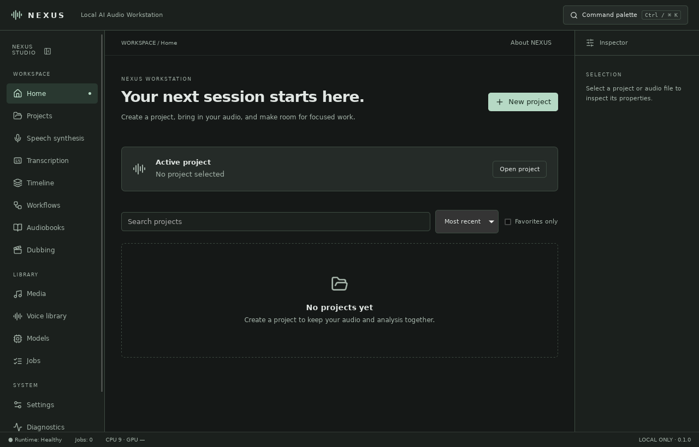
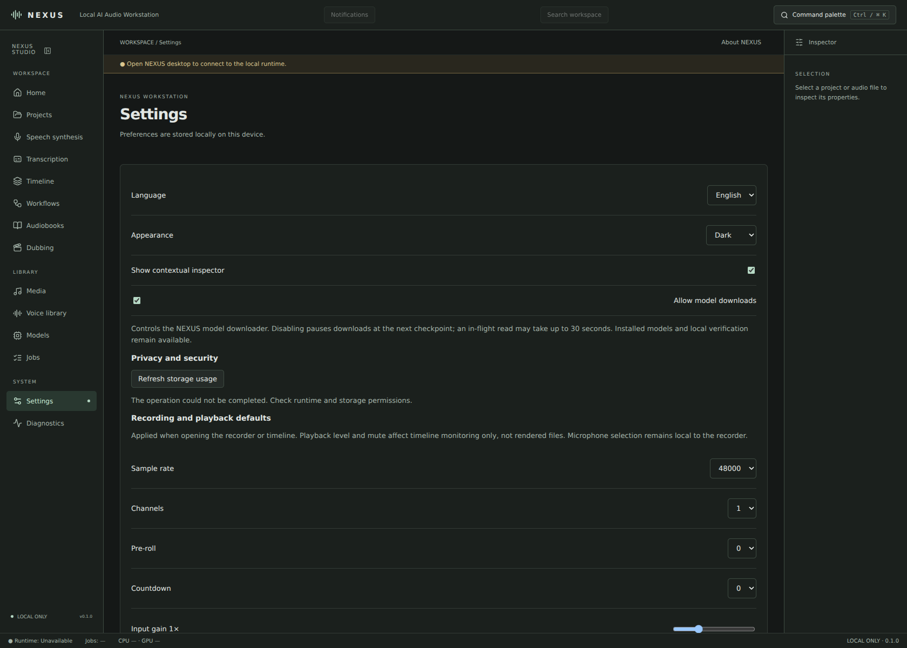

<div align="center">

# NEXUS

**Local-First Audio Workspace, AI Speech Synthesis & Multitrack Production Suite**

[](#)
[](LICENSE)
[](#architecture--stack)
[](#installation--downloads)
[-success.svg)](#)

[Features](#key-features) · [Installation](#installation--downloads) · [Build from Source](#building-from-source) · [CLI Usage](#cli-interface) · [Documentation](#documentation)

</div>

---

**NEXUS** is a self-contained, local-first desktop audio environment engineered for voice production, transcription, and multitrack timeline mixing. Powered by a Rust process supervisor and a local Python/FastAPI inference engine, NEXUS runs speech synthesis (**Kokoro**) and speech-to-text (**Whisper**) directly on your hardware—with zero cloud dependencies and zero telemetry.

Available in **English** and **Polski**.

<p align="center">
  
  <br>
  <em>Main project workspace and audio asset manager</em>
</p>

<p align="center">
  
  <br>
  <em>Runtime configuration, model management, and storage preferences</em>
</p>

---

## Key Features

| Module | Capabilities |
| :--- | :--- |
| **Workspace & Assets** | Create, rename, favorite, and search projects with recoverable trash management. Managed WAV import/export with automatic **SHA-256** integrity verification and **PCM16** signal analysis (peak detection, RMS in dBFS). |
| **Local AI Speech (TTS)** | High-quality local voice synthesis powered by **Kokoro**. Chunked audio generation allows instantaneous job cancellation between segments without losing cached engine state. |
| **AI Transcription (STT)** | Local **Whisper** transcription pipeline paired with a rich transcript editor featuring revision history, multi-speaker tagging, `SRT`/`VTT` import, and `TXT`/`SRT`/`VTT`/`JSON` export. |
| **Multitrack Timeline** | Non-destructive timeline arrangement supporting up to 32 tracks and 64 clips. Renders master mixes directly to uncompressed WAV (`24` / `44.1` / `48 kHz`, Mono or Stereo). |
| **Durable Job Engine** | SQLite-backed asynchronous task queue with cancellation, automatic retries, and crash recovery. Dedicated execution lanes isolate heavy model downloads from active media processing. |
| **Model Manager** | Pinned, checksum-verified weight downloads with built-in pause, resume, integrity verification, and clean uninstallation. |
| **Backups & CLI** | Portable, checksummed workspace archives for instant backup/restore, plus a standalone headless CLI for batch operations and automation. |
| **Process Security** | Authenticated loopback runtime (`127.0.0.1`), strict Rust supervisor process ownership, and a restricted IPC proxy bridging the UI and backend. |

> **Extended Workspaces:** Advanced pipelines for **Workflows**, **Audiobooks**, and **Dubbing** are built into the engine and can be unlocked in the sidebar by compiling the frontend with `VITE_NEXUS_EXPERIMENTAL=1`.

---

## Installation & Downloads

Download the latest prebuilt installer for your platform from the [**Releases**](../../releases) page, or follow the platform-specific instructions below.

### Windows (10 / 11 — x64)
1. Download `NEXUS_0.1.0_x64-setup.exe` or `NEXUS_0.1.0_x64_en-US.msi` from Releases.
2. Run the installer and launch **NEXUS** from the Start Menu.
3. *(Optional)* Install **FFmpeg** via Winget to enable MP3, M4A, FLAC, OGG, and AAC import:
   ```powershell
   winget install Gyan.FFmpeg
   ```

### macOS (Apple Silicon & Intel)
1. Download `NEXUS_0.1.0_aarch64.dmg` (M1/M2/M3/M4) or `NEXUS_0.1.0_x64.dmg` (Intel).
2. Drag **NEXUS.app** into your `/Applications` folder.
3. If macOS Gatekeeper prompts on first launch, clear the quarantine attribute:
   ```sh
   xattr -cr /Applications/NEXUS.app
   ```
4. *(Optional)* Install **FFmpeg** via Homebrew for extended codec support:
   ```sh
   brew install ffmpeg
   ```

### Linux (AppImage / Debian / Fedora)
1. Download `.AppImage` or `.deb` from the Releases page:
   ```sh
   # AppImage
   chmod +x NEXUS_0.1.0_amd64.AppImage
   ./NEXUS_0.1.0_amd64.AppImage

   # Debian / Ubuntu (.deb)
   sudo apt install ./nexus_0.1.0_amd64.deb
   ```
2. Ensure **FFmpeg** is installed on your system for compressed audio format support:
   ```sh
   # Ubuntu / Debian
   sudo apt install ffmpeg

   # Fedora
   sudo dnf install ffmpeg

   # Arch Linux
   sudo pacman -S ffmpeg
   ```

---

## Building from Source

### 1. System Prerequisites

Ensure you have **Python 3.11+**, **Node.js 22+**, **stable Rust**, and the native Tauri build dependencies installed for your OS. Clone the repository into a path **without spaces or parentheses**.

<details>
<summary><b>Linux System Dependencies (Ubuntu / Fedora / Arch)</b></summary>

```sh
# Debian / Ubuntu
sudo apt update && sudo apt install -y \
  libwebkit2gtk-4.1-dev build-essential curl wget file \
  libxdo-dev libssl-dev libayatana-appindicator3-dev librsvg2-dev ffmpeg

# Fedora
sudo dnf install -y \
  webkit2gtk4.1-devel openssl-devel curl wget file \
  libappindicator-gtk3-devel librsvg2-devel libxdo-devel gcc-c++ ffmpeg

# Arch Linux
sudo pacman -S --needed \
  webkit2gtk-4.1 base-devel curl wget file openssl \
  appmenu-gtk-module libappindicator-gtk3 librsvg xdotool ffmpeg
```
</details>

<details>
<summary><b>Windows System Dependencies</b></summary>

- [Microsoft C++ Build Tools](https://visualstudio.microsoft.com/visual-cpp-build-tools/) (Desktop development with C++)
- [WebView2 Runtime](https://developer.microsoft.com/en-us/microsoft-edge/webview2/) (pre-installed on Windows 11)
- Python 3.11+, Node.js 22+, and Rust (`rustup`)
</details>

<details>
<summary><b>macOS System Dependencies</b></summary>

```sh
xcode-select --install
brew install python@3.11 node@22 rustup-init ffmpeg
```
</details>

### 2. Development Setup

Initialize the Python virtual environment, install the AI runtime, and launch the supervised desktop workspace:

```sh
# 1. Set up Python runtime & AI dependencies
python -m venv .venv
. .venv/bin/activate            # Windows PowerShell: .venv\Scripts\Activate.ps1
python -m pip install -e "./runtime[ai,test]"

# 2. Install frontend dependencies & launch Tauri desktop app
cd apps/desktop
npm ci
npm run desktop
```

> **Note:** Running `npm run dev` alone launches the frontend in browser-only preview mode without connecting to the authenticated loopback runtime. Always use `npm run desktop` for the full native experience.

### 3. Packaging Native Installers

To compile a standalone native bundle (`.exe`, `.msi`, `.dmg`, `.AppImage`, `.deb`) with the embedded Python runtime:

```sh
python -m pip install pyinstaller
python scripts/package_runtime.py
cd apps/desktop && npm run tauri build
```

Target bundles are generated under `apps/desktop/src-tauri/target/release/bundle/`. Build natively on each target OS—see [Platform Builds](docs/PLATFORM_BUILDS.md) for cross-platform details.

---

## CLI Interface

NEXUS ships with an offline CLI for managing projects, inspecting workspaces, and automating tasks without launching the GUI (ensure the desktop application is closed before accessing the same data directory):

```sh
nexus --data-dir /path/to/workspace projects list
```

See the full [CLI Reference](docs/CLI.md) for available subcommands and flags.

---

## Architecture & Technical Specifications

NEXUS decouples the UI from heavy DSP and neural inference through a three-tier local architecture:

1. **Frontend (`apps/desktop`):** React + TypeScript interface rendered inside a lightweight Tauri window.
2. **Supervisor (`nexus-supervisor`):** Rust daemon managing child process lifecycle, IPC routing, and loopback authentication tokens.
3. **Runtime (`runtime`):** Python/FastAPI service executing SQLite job queues, audio DSP, Kokoro TTS, and Whisper STT.

| Parameter | Specification |
| :--- | :--- |
| **Native Audio Format** | Uncompressed WAV (`PCM16`) |
| **Extended Formats (via FFmpeg)** | `MP3`, `M4A`, `FLAC`, `OGG`, `AAC` |
| **File Size Thresholds** | `512 MiB` max import · `32 MiB` direct in-app playback |
| **Timeline Capacity** | Up to `32 tracks`, `64 clips`, `60 minutes` max sequence length |
| **Render Sample Rates** | `24 kHz`, `44.1 kHz`, `48 kHz` (Mono / Stereo) |
| **Metering Standard** | Peak & RMS (`dBFS`) |
| **Data Retention** | Safe soft-delete to local recoverable trash (no automatic purging) |

---

## Quality Assurance & Verification

Run the full linting and automated test suite across Python, Rust, and TypeScript:

```sh
# Python runtime lint & test suite
python -m ruff check runtime && python -m ruff format --check runtime
python -m pytest runtime/tests -q

# Rust supervisor formatting, static analysis & integration tests
cargo fmt --all -- --check
cargo clippy -p nexus-supervisor -- -D warnings
NEXUS_TEST_PYTHON="$(command -v python)" cargo test -p nexus-supervisor -- --include-ignored

# Desktop UI lint, unit tests & production build check
cd apps/desktop && npm run lint && npm test && npm run build
```

---

## Documentation

- [**Architecture Overview**](ARCHITECTURE.md) — Process model, IPC boundaries, and database schema.
- [**Security Model**](SECURITY.md) — Loopback authentication, token handling, and sandboxing.
- [**User Guide**](docs/USER_GUIDE.md) — Walkthrough of workspaces, timeline mixing, and subtitle workflows.
- [**AI Models**](docs/MODELS.md) — Supported Kokoro & Whisper weights, checksums, and caching.
- [**Platform Builds**](docs/PLATFORM_BUILDS.md) — OS-specific packaging and installer configuration.
- [**Roadmap**](docs/ROADMAP.md) · [**Changelog**](CHANGELOG.md) · [**Contributing**](CONTRIBUTING.md) · [**Archive**](docs/archive)

---

## Versioning & License

The canonical version string is maintained in `runtime/pyproject.toml`. After bumping the version, synchronize all workspace manifests by running:

```sh
python scripts/sync_version.py
```

*Model weights are downloaded on demand inside the application and are not bundled in the repository.*

Licensed under the **MIT License** © DushaneW.
